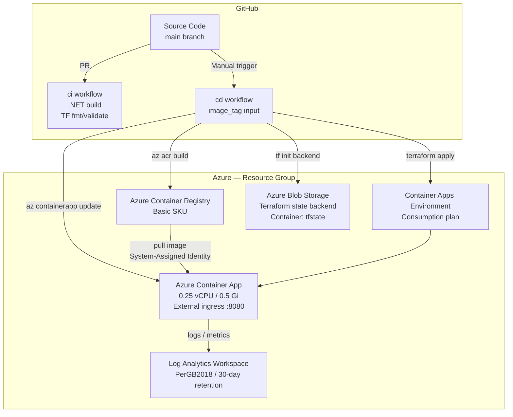

# Architecture

## Overview

The app is a **.NET 10 Blazor Server** single-project solution containerised with Docker and hosted on **Azure Container Apps**. Infrastructure is fully described in Terraform and deployed through GitHub Actions.

```
Developer
  │
  ├─ PR → GitHub Actions ci  ──► .NET build + Terraform fmt/validate
  │
  └─ Merge + Manual trigger
       └─ GitHub Actions cd
            ├─ terraform apply  ──► Azure (idempotent infra)
            ├─ docker build / push ──► Azure Container Registry
            └─ az containerapp update ──► Azure Container App (new image)
```

---

## Component diagram



---

## Infrastructure resources (Terraform)

| Resource | Terraform type | Notes |
|---|---|---|
| Log Analytics Workspace | `azurerm_log_analytics_workspace` | PerGB2018, 30-day retention |
| Azure Container Registry | `azurerm_container_registry` | Basic SKU, admin disabled |
| Container Apps Environment | `azurerm_container_app_environment` | Linked to Log Analytics |
| Container App | `azurerm_container_app` | Single revision, System-Assigned identity, pulls from ACR |

Names are derived from variables and suffixed with a random 6-character string to avoid global name collisions. State is stored remotely in an Azure Blob Storage container (`tfstate`), bootstrapped once via the `infra-init` workflow.

---

## Application

| Layer | Detail |
|---|---|
| Framework | .NET 10 Blazor Server (`AddInteractiveServerComponents`) |
| Health check | `GET /healthz` — mapped via `MapHealthChecks` |
| Error handling | Unhandled exceptions → `/Error` (`UseExceptionHandler`); 404s → `/not-found` (`UseStatusCodePagesWithReExecute`) |
| Security | HSTS enabled in production; HTTPS redirect; antiforgery middleware |
| Static assets | Served via `MapStaticAssets` (fingerprinted, compressed) |

### Key pages

| Route | Component | Purpose |
|---|---|---|
| `/` | `Home.razor` | Landing page |
| `/counter` | `Counter.razor` | Interactive server-side counter demo |
| `/weather` | `Weather.razor` | Sample data fetch demo |
| `/not-found` | `NotFound.razor` | 404 status-code redirect target |
| `/healthz` | — | ASP.NET Core health check endpoint |

---

## Docker build

The `Dockerfile` uses a two-stage build:

1. **Build stage** — `mcr.microsoft.com/dotnet/sdk:10.0`  
   Restores NuGet packages, then publishes in Release mode with `UseAppHost=false`.

2. **Runtime stage** — `mcr.microsoft.com/dotnet/aspnet:10.0`  
   Copies the published output, sets `ASPNETCORE_URLS=http://+:8080`, exposes port 8080.

The Container App's ingress `target_port` is set to `8080` to match.

---

## CI/CD workflows

### `infra-init` (run once)

```
workflow_dispatch
  └─ az group create
  └─ az storage account create  (Standard_LRS, no public blob access)
  └─ az storage container-rm create  (tfstate, private)
  └─ az role assignment create  (Storage Blob Data Contributor for the deployment service principal)
```

### `ci` (pull requests to `main`)

```
pull_request / workflow_dispatch
  └─ dotnet restore + build (Release)
  └─ terraform fmt -check
  └─ terraform init (remote backend; falls back to local backend when creds are absent or backend RBAC is missing)
  └─ terraform validate
```

### `cd` (manual, requires `image_tag` input)

```
workflow_dispatch (image_tag)
  └─ az login (service principal)
  └─ terraform init + validate + apply
  └─ az acr build  →  ACR  (builds & pushes image remotely)
  └─ az containerapp update --image <acr>/<image>:<tag>
```

---

## Repository variable resolution

All three workflows share the same logic:

```
RESOURCE_GROUP   = vars.RESOURCE_GROUP   || "rg-workshop-<github-actor>"
TF_STORAGE_ACCOUNT = vars.TF_STORAGE_ACCOUNT || "strgworkshop<sha256(repo+actor)[0:10]>"
```

---

## Secrets & variables reference

| Name | Type | Used by |
|---|---|---|
| `SANDBOX_CLIENT_ID` | Variable | All workflows — service principal login |
| `SANDBOX_TENANT_ID` | Variable | All workflows — service principal login |
| `SANDBOX_CLIENT_SECRET` | **Secret** | All workflows — service principal login |
| `SANDBOX_SUBSCRIPTION_ID` | Variable | All workflows — optional; sets active subscription |
| `RESOURCE_GROUP` | Variable | All workflows — optional override |
| `TF_STORAGE_ACCOUNT` | Variable | All workflows — optional override |
